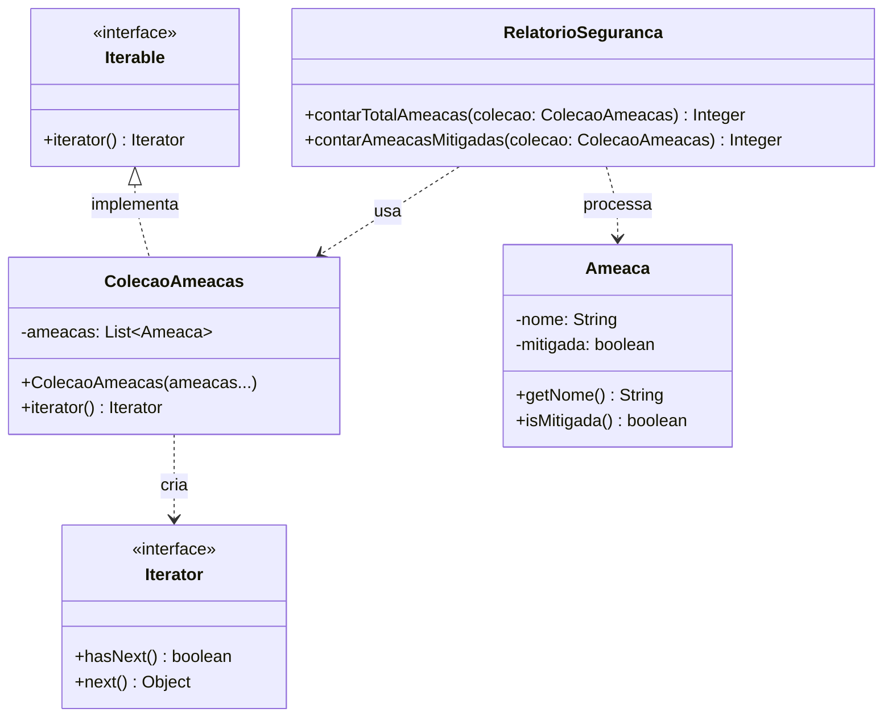

# Padrão Iterator - Coleção de Ameaças de Segurança

[](https://openjdk.java.net/)
[](https://junit.org/junit5/)

Implementação do padrão de projeto **Iterator** (Comportamental) em Java. O projeto demonstra como fornecer uma maneira de acessar sequencialmente os elementos de um objeto agregado sem expor sua representação subjacente, delegando a iteração para a interface nativa `Iterable`.

---

## Descrição e Intenção

**Definição (GoF):** Fornecer uma maneira de acessar sequencialmente os elementos de um objeto agregado sem expor sua representação subjacente.

### O Problema (Exposição da Estrutura Interna)
Em um sistema de segurança, precisamos processar coleções de dados heterogêneos (ex: lista de ameaças, logs de acesso, usuários bloqueados). Se o cliente acessar diretamente a estrutura interna (ex: um `ArrayList` ou `HashSet`), ele se acopla fortemente a essa implementação. Se no futuro precisarmos mudar a estrutura de dados (ex: de `ArrayList` para uma Árvore de Merkle para verificação de integridade), todo o código cliente que faz loops `for` ou acessa índices terá que ser reescrito, violando o **Princípio Aberto/Fechado (OCP)**.

### A Solução
O padrão Iterator introduz uma interface de iteração (`Iterable` e `Iterator` do Java). A coleção (`ColecaoAmeacas`) implementa `Iterable` e delega a criação do iterador para sua estrutura interna. O cliente (`RelatorioSeguranca`) usa o laço `for` aprimorado ou o iterador explícito, conhecendo apenas a interface dos elementos (`Ameaca`), e não como eles estão armazenados.

---

## Estrutura do Projeto

```text
src/
├── main/
│   └── padroescomportamentais/iterator/
│       ├── Ameaca.java                 (Elemento Concreto)
│       ├── ColecaoAmeacas.java         (Aggregate: implementa Iterable)
│       └── RelatorioSeguranca.java     (Client: utiliza o iterador)
│
└── test/
    └── padroescomportamentais/iterator/
        └── RelatorioSegurancaTest.java (Casos de teste)
```
## Diagrama de Classes
O diagrama abaixo ilustra a relação-chave: a coleção implementa a interface `Iterable`, permitindo que o cliente itere sobre ela sem conhecer sua implementação concreta (no caso, um `ArrayList` interno).



### Análise Crítica: Vantagens e Pontos Cegos

É fundamental diferenciar os benefícios teóricos dos riscos práticos de implementação.

#### Vantagens (Fatos)
* **Princípio Aberto/Fechado (OCP):** O código cliente não precisa ser alterado se a estrutura interna da coleção mudar (ex: de `ArrayList` para `LinkedList` ou uma estrutura de árvore customizada).
* **Princípio da Responsabilidade Única (SRP):** A lógica de travessia (*traversal*) é removida da classe de coleção e encapsulada no objeto iterador, limpando a interface da coleção.
* **Múltiplas Travessias:** Permite ter mais de uma travessia pendente na mesma coleção simultaneamente (cada chamada a `iterator()` cria um novo estado de travessia).

#### Pontos Cegos e Contrapontos (Onde o padrão exige cuidado)
1. **Exceção de Modificação Concorrente (`ConcurrentModificationException`):**
   * **Fato:** Se a coleção for modificada (adicionar/remover elementos) enquanto um iterador está percorrendo-a, o iterador *fail-fast* do Java lançará uma exceção.
   * **Contraponto:** Para evitar isso em ambientes multithread, use coleções *thread-safe* (ex: `CopyOnWriteArrayList`) ou itere sobre uma cópia defensiva da coleção (ex: `List.copyOf(colecao)`), como demonstrado em padrões como o Observer.
2. **Overengineering em Coleções Simples:**
   * **Fato:** Criar classes iteradoras customizadas do zero (com `hasNext` e `next` manuais) para uma lista simples adiciona complexidade desnecessária.
   * **Contraponto:** A abordagem mais pragmática e alinhada ao Java moderno (e ao exemplo do professor) é fazer a coleção implementar `Iterable` e delegar diretamente para o iterador nativo da estrutura de dados subjacente (`return this.listaInterna.iterator()`).

---

### Diferença Crucial: Iterator vs. Acesso Direto à Coleção

Esta é a confusão mais comum: achar que usar um `for` em um `ArrayList` já é "usar o padrão". A diferença está no **acoplamento**.

| Característica | Acesso Direto à Coleção | Padrão Iterator (via `Iterable`) |
| :--- | :--- | :--- |
| **Acoplamento** | **Alto:** o cliente sabe que é um `ArrayList` e pode usar `.get(i)` ou `.size()`. | **Baixo:** o cliente só sabe que pode "iterar", sem saber o tipo da coleção. |
| **Flexibilidade** | **Baixa:** mudar a estrutura de dados quebra o código cliente. | **Alta:** a estrutura interna pode mudar sem afetar o cliente. |
| **Mecanismo** | O cliente controla o índice e os limites da coleção. | O objeto iterador controla o estado da travessia (posição atual). |
| **Exemplo** | `for (int i = 0; i < lista.size(); i++) { lista.get(i); }` | `for (Ameaca a : colecao) { ... }` |

---

### Testes

O projeto contém testes unitários (JUnit 5) que validam:
* O `RelatorioSeguranca` consegue iterar e contar o total de elementos usando o laço `for` aprimorado.
* O `RelatorioSeguranca` consegue iterar e filtrar elementos (ex: apenas mitigados) usando o iterador explícito.
* A adição de novos tipos de elementos ou a mudança da estrutura interna de `ColecaoAmeacas` não exige alteração nos métodos de `RelatorioSeguranca`.

---

### Tecnologias Utilizadas

| Tecnologia | Versão | Finalidade no Projeto |
| :--- | :--- | :--- |
| **Java** | 21 | Linguagem de programação principal |
| **Maven** | 3.9+ | Gerenciamento de dependências e automação de build |
| **JUnit 5** | 5.9.x | Framework para execução dos testes unitários |
| **Draw.io / Mermaid** | Web | Criação e renderização dos diagramas UML |
